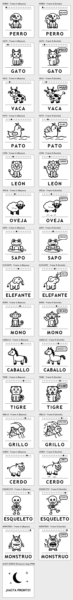

# 🐾 Mi Libro de Animales — ESP32-S3 e-Paper Interactivo

Libro infantil interactivo autónomo para la placa **Waveshare ESP32-S3-ePaper-1.54** (`ESP32-S3`, pantalla e-Paper 200×200 1-bit `SSD1681`, códec de audio `ES8311` + amplificador `NS4150B`, 4 MB LittleFS).

Diseñado para aprender los **15 personajes**, sus **sonidos reales** y el **deletreo letra por letra** en español latinoamericano con sincronización visual en pantalla sin luz azul y consumo mínimo en Deep Sleep.

<p align="center">
  
</p>

---

## ✨ Características Principales

- **15 Personajes Ilustrados (2 frames cada uno: Reposo + Acción):**
  `Perro`, `Gato`, `Vaca`, `Pato`, `León`, `Oveja`, `Sapo`, `Elefante`, `Mono`, `Caballo`, `Tigre`, `Grillo`, `Cerdo`, `Esqueleto` y `Monstruo`.
- **Modo Deletreo Interactivo (activado por defecto):**
  1. Reproduce el **sonido del animal** y anima el sprite a Frame B.
  2. Subraya **letra por letra** en la pantalla e-Paper mientras pronuncia cada letra (`B` = *"be larga"*, `V` = *"ve corta"*, `W` = *"doble ve"*, `Y` = *"i griega"*).
  3. Marca **toda la palabra** con subrayado continuo y flechas laterales `► PALABRA ◄` mientras dice el nombre completo.
  4. Repite el **sonido del animal** al cierre y vuelve a Frame A.
- **Audio Limpio sin Cortes ni Chasquidos:**
  - Sesión continua de amplificador (`NS4150B`) con *soft-start* y pre-roll I2S para que la primera letra suene nítida desde el primer milisegundo.
  - WAVs `16 kHz, 16-bit, Mono` normalizados para parlante 1W/8Ω.
- **Portada Ilustrada en Reposo:**
  - Al apagar con `PWR`, muestra *"¡HASTA PRONTO!"* durante 1.8 s y deja fija la portada ilustrada en la e-Paper sin consumo de batería.
- **Actualización Inteligente (USB + OTA Exponencial):**
  - Check-ins WiFi breves en Deep Sleep (`10 min` la primera hora → backoff exponencial `20..720 min` → apagado automático tras 14 ciclos sin updates).
- **Studio Web Interactivo (`tools/studio_server.py`):**
  - Simulador e-Paper en el navegador (`http://127.0.0.1:8765`) para comparar 8 fuentes de voz, velocidades independientes y estilos de pronunciación.

<p align="center">
  
</p>

---

## 🎮 Controles (2 Botones)

| Botón | Acción | Comportamiento |
| :--- | :--- | :--- |
| **`BOOT`** (`GPIO 0`) | **Clic corto** | Reproduce el animal actual (Sonido + Deletreo + Palabra + Sonido). |
| **`BOOT`** (`GPIO 0`) | **Mantener 3 s** | Activa / desactiva el modo deletreo (ícono `A` / `A̶` arriba a la izquierda). |
| **`PWR`** (`GPIO 18`) | **Clic corto** | Pasa al siguiente animal (si está sonando/deletreando, **cancela al instante** y salta). |
| **`PWR`** (`GPIO 18`) | **Mantener ~2 s** | Muestra *"¡HASTA PRONTO!"*, fija la portada en e-Paper y entra en **Deep Sleep**. |

> Luego de **3 minutos** de inactividad entra automáticamente en Deep Sleep conservando la pantalla actual. Pulsa `BOOT` o `PWR` para despertar.

---

## 🧱 Arquitectura

```text
projects/esp32-animales-epaper/
├── include/
│   ├── app_state.h          # Máquina de estados pura (testeable en host)
│   ├── audio_es8311.h       # Driver I2C/I2S ES8311 + sesión continua NS4150B
│   ├── board_pins.h         # Pinout Waveshare ESP32-S3-ePaper-1.54
│   ├── epd_driver.h         # Driver SPI SSD1681 16 MHz (Full + Partial)
│   └── ota_manager.h        # Check-in OTA UDP:32320 con backoff exponencial
├── src/
│   ├── main.cpp             # Dual-Core FreeRTOS (Core 0: Audio | Core 1: Input/EPD)
│   └── assets/
│       ├── animals_gfx.h    # Bitmaps PROGMEM 1-bit + tabla ANIMALS[15]
│       └── cover_gfx.h      # Portada 200x200 para Deep Sleep
├── data/                    # Partición LittleFS (~3.875 MB)
│   ├── sounds/*.wav         # 15 sonidos de animales/personajes
│   ├── letters/*.wav        # 26 letras en voz única (gtts es-419)
│   └── names/*.wav          # 15 nombres pausados (gtts es-419)
├── tools/
│   ├── flash.py             # Auto-flasheo USB (COM) o espera OTA UDP:32320
│   ├── studio_server.py     # Servidor multi-hilo del Studio web
│   ├── studio.html          # Interfaz web simulador e-Paper + selector de voces
│   ├── generate_graphics.py # Generador de bitmaps 1-bit y preview_sheet.png
│   ├── generate_cover.py    # Generador de portada 200x200 (cover_gfx.h)
│   ├── prepare_letters.py   # Generador de letras y nombres WAV 16 kHz mono
│   └── sprites/*.py         # Ilustraciones vectoriales 4x supersampled
└── tests/
    └── test_assets_and_firmware.py
```

---

## 🚀 Cómo Compilar, Probar y Flashear

```powershell
cd projects\esp32-animales-epaper

# 1. Ejecutar suite de verificación de assets, particiones y headers
pytest tests/test_assets_and_firmware.py -v

# 2. Compilar firmware
pio run -e esp32-s3-paper

# 3. Flashear solo firmware (detecta USB o espera check-in OTA)
python tools/flash.py

# 4. Flashear firmware + LittleFS completo (data/)
python tools/flash.py --both
```

### Abrir el Studio Web Interactivo

```powershell
cd projects\esp32-animales-epaper
python tools/studio_server.py
# Abre http://127.0.0.1:8765 en tu navegador
```
